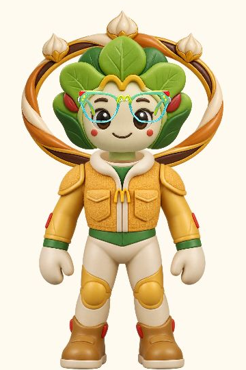
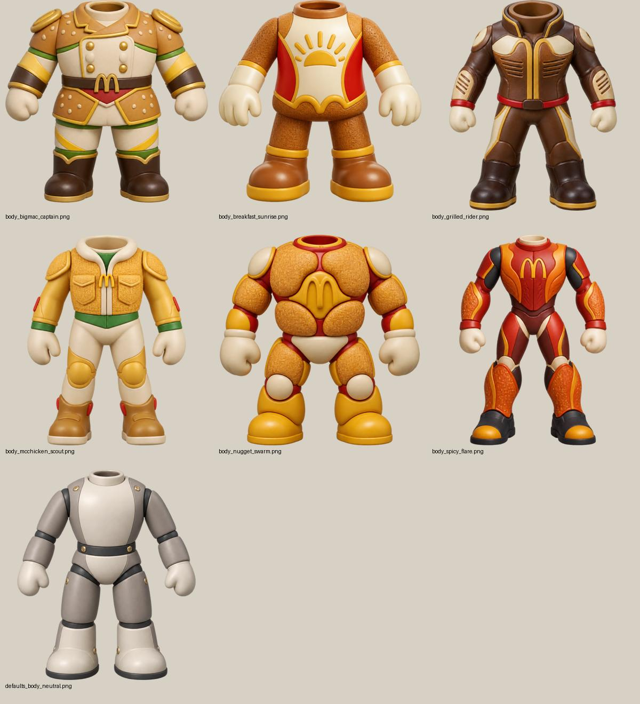
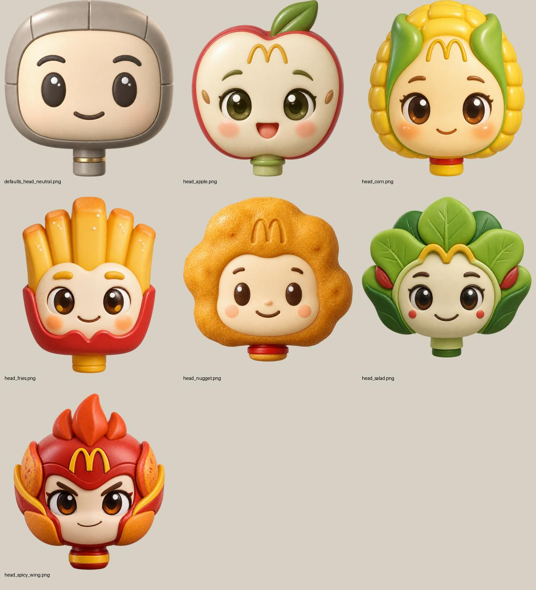
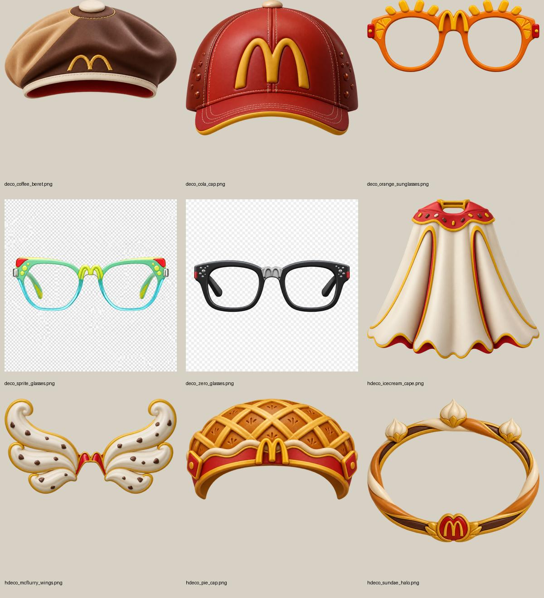

# McMoment 麦麦时刻

> **这一刻，刚刚好。**
>
> McMoment 是一个基于麦当劳 MCP 的情境感知型用餐助手：用户只需要说出此刻的状态、人数、预算或饮食偏好，系统就能从真实营养数据中组合出一份适合当前场景的餐食方案，并把这份订单进一步“长”成一个独一无二的订单形象。



## 参赛简介

传统点餐工具通常从“我想吃什么”开始，McMoment 更关注“我现在处于什么情境”。它把用户输入的时间、人数、偏好和热量目标转化为可执行的餐食建议，再通过麦当劳 MCP 查询真实营养数据，完成从情境理解、方案组合到视觉化表达的体验闭环。

项目的核心概念是：

```text
订单即 DNA，餐品即部件，
每一次选择，都会生成一个只属于这一单的订单形象。
```

当前版本提供两个可直接体验的入口：

- **沉浸入口**：输入“刚健身完，想吃低热量、高蛋白的”，再设置人数和热量上限，生成随机餐食组合。
- **组局计划**：选择聚餐人数、预算、时间和口味偏好，为每位朋友生成一份清楚的餐品清单，并展示对应的订单形象。

## 核心功能

### 1. 从“点什么”升级为“此刻怎么吃”

- 支持自然语言描述当前状态和饮食偏好。
- 支持 1～3 人餐食推荐、热量上限和预算输入。
- 根据用户偏好对主食、小食和饮品进行组合与排序。
- 推荐结果标注数据来源和限制，避免把静态假数据包装成实时结果。

### 2. 基于麦当劳 MCP 的真实数据推荐

- 启动时连接麦当劳 MCP Server，并读取实时 Tool 描述和参数 schema。
- 点击“生成随心订单”后调用 `list-nutrition-foods` 获取营养餐品数据。
- 在本地完成主食、小食、饮品的组合、热量计算、偏好匹配和随机抽取。
- 多人场景可以按人数生成不同搭配，并展示每份餐品的热量信息。

### 3. 多人组局方案

- 选择人数、预算和聚餐时间。
- 输入“想吃辣的”“有人不喝含糖饮料”等群体偏好。
- 自动为每位朋友生成一份可读的餐品清单。
- 页面同时展示参与者和对应的订单形象，让“组局”从一张菜单变成一场可视化的聚餐预览。

### 4. 订单形象：项目的核心记忆点

McMoment 不把推荐结果停留在文字和卡片上，而是把订单拆解为可复用的透明 PNG 部件，再按餐品类别进行拼装：

| 订单来源 | 形象部件 | 视觉作用 |
| --- | --- | --- |
| 主餐 | 身体骨架 | 决定角色的整体体型和主视觉风格 |
| 小食 | 头部 | 生成薯条、玉米、沙拉、鸡块等不同表情与外轮廓 |
| 饮料 | 日常装饰 | 例如眼镜、帽子等配件，增加随机性和个性 |
| 甜品 | 高级装饰 | 例如翅膀、光环、披风等庆祝性元素 |

订单形象的特点：

- **订单可视化**：角色不是随机贴图，而是由本次推荐中的餐品来源决定。
- **组合可复用**：同一套部件可以组合出大量不同角色，不需要为每个订单重新生成整张图片。
- **部件可替换**：身体、头部和装饰分别加载，透明留白、不同尺寸和缺失装饰都能处理。
- **结果有反馈**：确认方案后展示“模拟下单成功”，随后动态拼装专属角色，形成从推荐到结果的记忆点。
- **适合多人分享**：多人组局可以同时展示一排由订单组成的小队，天然适合社交传播和活动展示。

### 特色部件一览

这些透明 PNG 素材按身体、头部和装饰分层复用。身体素材当前包含完整四肢；小食主题生成头部，饮品主题对应眼镜、帽子等日常装饰，甜品主题对应翅膀、光环和披风等高级装饰。

**身体：从早餐日出到麦辣战甲**



**头部：薯条、玉米、苹果与鸡块角色**



**装饰：饮品配件与甜品造型**



## 体验流程

```text
输入当前情境
    ↓
读取麦当劳 MCP 营养数据
    ↓
按偏好、人数和热量组合餐品
    ↓
随机抽取一份推荐方案
    ↓
确认方案，进入模拟下单
    ↓
按订单来源选择部件
    ↓
拼装并展示专属订单形象
```

## 项目优点

### 有真实业务连接

推荐不是本地硬编码的菜单演示，而是通过麦当劳 MCP 获取营养数据；服务端会根据 MCP 返回的 Tool schema 校验调用参数，并记录脱敏后的调用日志，便于排查和复现。

### 有清晰的创新表达

“订单形象”把抽象的餐品组合变成了可感知的角色结果：用户选择的主餐、小食、饮料和甜品会映射到角色的不同部件，既能解释推荐结果，也让每次下单具备独特性。

### 有可扩展的技术结构

- 前端页面与本地 API 分离，避免把 MCP Token 暴露给浏览器。
- 角色渲染器独立封装，支持透明边界检测、颈部对齐、装饰分层和中性部件回退。
- 部件资源采用统一透明 PNG 规范，后续可以继续增加餐品风格而不改动核心拼装逻辑。
- 推荐、组局和订单形象共用同一套餐品来源与展示逻辑。

### 有完整的产品体验

项目同时覆盖输入、筛选、推荐、解释、确认、进度和结果展示，不只是一个 API 调用 Demo。个人推荐解决“我现在吃什么”，组局模式解决“大家一起吃什么”，订单形象则负责把结果留下来。

## 技术方案

```text
浏览器 UI
  ├─ 沉浸入口：情境输入 + 人数/预算/热量筛选
  ├─ 组局计划：多人条件 + 偏好 + 分人餐品
  └─ 订单形象：透明 PNG 部件拼装 + 动画展示
          ↓
本地 Node.js API
  ├─ MCP 会话初始化与 tools/list
  ├─ list-nutrition-foods 调用
  ├─ 餐品分类、组合、偏好匹配、热量计算
  └─ 角色资源清单与静态资源服务
          ↓
麦当劳 MCP Server
```

主要目录：

```text
McMoment/
├── README.md                         # 项目说明
├── 启动 McMoment.bat                 # Windows 一键启动
├── png/                              # 订单形象部件素材
├── srcDoc/                           # 设计方案、订单 DNA 与生成提示词
└── mcd-skill-project/
    ├── src/index.js                  # MCP 连接与本地 API
    ├── web/index.html                 # 交互页面
    ├── web/character-renderer.js     # 角色部件拼装器
    ├── test/                          # 角色渲染测试
    ├── artifacts/                     # 拼接检查与展示素材
    └── MCP_INTEGRATION.md             # MCP 集成说明
```

## 快速运行

### 环境要求

- Node.js 18 或更高版本。
- 可用的麦当劳 MCP Token。

### Windows 一键启动

1. 在 `mcd-skill-project/` 下创建 `.env` 文件。
2. 写入 MCP Token：

   ```env
   MCD_MCP_TOKEN=你的真实Token
   ```

3. 双击仓库根目录的 `启动 McMoment.bat`。
4. 浏览器访问 `http://127.0.0.1:3000/`。

### 命令行启动

```bash
cd mcd-skill-project
npm install
npm start
```

运行测试：

```bash
npm test
```

## 当前版本边界

为保证参赛演示真实、清晰，当前版本有意保留以下边界：

- 当前推荐入口调用的是只读营养工具，不会创建真实订单。
- “确认方案，继续下单”展示的是 5 秒模拟下单流程，完成后生成订单形象。
- MCP 当前返回的营养数据不包含价格，因此预算只作为页面条件展示，不能被标记为已核验的预算内方案。
- 餐品供应、价格和可售状态应以麦当劳官方实时结果为准。

后续接入真实交易时，可以在现有推荐结果和订单形象基础上继续增加门店、计价、用户确认、真实下单和订单追踪能力。

## 相关文档

- [`mcd-skill-project/README.md`](mcd-skill-project/README.md)：安装、启动和资源说明
- [`mcd-skill-project/MCP_INTEGRATION.md`](mcd-skill-project/MCP_INTEGRATION.md)：MCP Server、Tool 与调用规则
- [`srcDoc/McMoment_订单DNA概念.md`](srcDoc/McMoment_订单DNA概念.md)：订单形象与部件协议
- [`srcDoc/McMoment_餐品部件生图提示词.md`](srcDoc/McMoment_餐品部件生图提示词.md)：餐品部件生成规范
- [`mcd-skill-project/CONTEST_DECLARATION.md`](mcd-skill-project/CONTEST_DECLARATION.md)：参赛声明

## 参赛声明

本项目为麦当劳程序员节创意开发大赛参赛作品，由参赛者独立开发，非麦当劳官方产品。项目输出仅供参考，不构成医疗、营养或其他专业建议；具体餐品信息、价格及供应状态以麦当劳官方渠道的实时结果为准。
